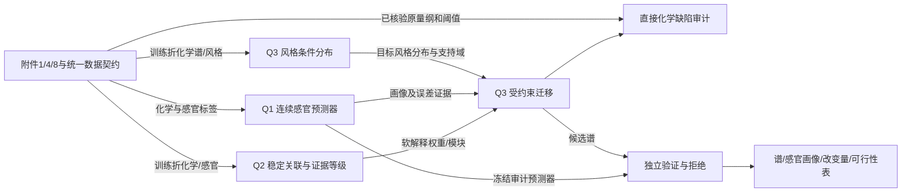

# Q3 独立方案 v0：风格分布学习与受约束迁移

> 2026-10-25；先读官方题面、附件 1/4/8 和本队数据契约后形成。本文件在本轮 GitHub、论文、CSDN 检索及重新阅读本地参考 Q3 内容前冻结，保留推导顺序。过往对照中已经接触过参考模型名称，因而“独立”指本轮从任务与数据重新论证，不表示从未接触这些模型。
> 状态：研究假说与实验设计；未训练 Q3，没有 Q3 性能结果；不修改 Q1/Q2 运行中的工作树。

## 1. 任务本质 → 难点 → 对策

**任务本质。** 从 250 款商用啤酒的横截面测量学习条件分布 `p(化合物谱 | 风格)`，产生有多样性的候选谱，再在接近目标风格的同时限制源谱改变量与缺陷风险。感官画像由 Q1 预测，变化解释使用 Q2 的稳定关联证据。输出是统计设计候选，不是已验证的配方或酿造控制动作。

| 数据/任务难点 | 数据依据 | 从约束推导出的对策 |
|---|---|---|
| 小样本高维、多风格不平衡 | 250×231；22 风格；Tripel 28、Kriek 10、Lambic 11、Pils/Lager 11 | 共享低维结构，再学风格差异；先与训练样本重采样/局部插值比较，不能由生成数量证明模型优秀 |
| 合理谱不仅是每列落在范围内 | 特征有相关结构、派生总量、不同量纲；并非都能当浓度 | 在低维联合结构中生成；约束后重新检查联合分布和派生字段，不独立裁剪后宣布有效 |
| 风格目标与缺陷限制可能冲突 | Pils/Lager 与 Tripel 的若干缺陷字段分布不同 | 在相同可行域内比较目标距离—改动代价的 Pareto 前沿；不可行也输出具体原因，不偷偷放宽缺陷上限 |
| Q1 对部分缺陷的预测较弱 | 本队既有 Q1 难目标记录；stale_hops 无对应单一化学浓度 | 直接浓度约束优先；感官缺陷保留独立风险栏、预测误差与拒绝机制，不能仅用同一预测器自证 |

## 2. 三问共用的对象与接口

Q1 是画像测量模型，不是“生成越高分越好”的唯一目标；Q2 提供统计证据，不提供因果效应或可操作酿造旋钮。Q3 不反向改变 Q1 冻结 CV 或 Q2 Top-3。

## 3. 原始数据只读核验

- `beer` 唯一连接主键，`beer_id` 不入模；附件 1 为 250×234（3 个元数据字段+231 特征），附件 4 为 250×53（3+50）。
- 附件 8 的校准表为 250×73（3+70）；可核验 37 个 log10 字段、33 个原尺度字段。其余字段不擅自反变换、不发明绝对浓度单位。
- DMS 是 log10、单位 μg/L；Diacetyl=`X2.3.butanedione` 为原尺度 mg/L 且缺失 9 个；4VG=`X4VG` 是 log10、单位 mg/L；trans-2-nonenal=`X.E..2.nonenal` 为原尺度 mg/L。
- 附件阈值 median/mean：DMS 19/17.25 μg/L，Diacetyl 0.09/0.29925 mg/L，4VG 0.20/0.206333… mg/L；trans-2-nonenal 两项缺失。不同汇总阈值作为情景，不把其差异当测量噪声。
- 校准表中部分零值与附件 1 的正数或对数地板并存；零是否低于检测限需要逐字段审计。不得直接把 `10^地板` 当真实检出浓度，也不得默认校准零就是绝对不存在。
- `stale_hops` 是附件 4 连续标准化目标；不是原始 0–6，也不是一种物质。其绝对阈值尚不可识别。

## 4. 从需求推导的三种候选

| 候选 | 变量与步骤 | 适用依据 | 风险与验证 | Q1/Q2 接口 |
|---|---|---|---|---|
| A：经验分布与局部重心生成 | 训练风格样本的邻域；在训练折标准化空间内对近邻非负加权，再校验/重算派生量 | 最少分布假设，给复杂模型设可信基线 | 插值收缩方差、可能近似复制；检查留出距离、相关结构、近邻复制率 | Q1 只做画像；Q2 可解释改动 |
| B：共享低维结构+风格收缩+受约束分布输运 | 全体训练化学谱拟合共享基底；风格偏移/残差分布向全体收缩；生成后约束迁移 | 小风格无法独立估计 231 维完整协方差；生成/迁移共用支持域 | 低维损失少数缺陷信号；把关键缺陷保留为显式坐标，比较留出条件分布 | Q1 分组可靠性决定软画像权重；Q2 只作软正则消融 |
| C：共享条件深度生成 | 条件 VAE/流/扩散联合学习风格与谱；约束采样或后验修复 | 允许非线性，多风格共享；GPU 可用 | 250 样本记忆/塌缩风险；不因算力足直接升主线，须胜过 A/B 且通过约束审计 | 仍需冻结 Q1 与独立分布评估 |

**暂定主线 B，A 必做，C 作为挑战者。** 选择基于样本结构和输出要求，具体统计分布与求解器待外部研究后决定；不预设 Copula、VAE 或均值平移必胜。

## 5. 迁移目标与缺陷口径

设源谱为 `x0`、目标风格为 `t`、候选谱为 `x`。在目标风格分布距离 `D_style(x,t)`、标准化改动代价 `C(x,x0)`、低可靠感官惩罚 `U(x)` 间做约束优化，绘制 Pareto 前沿。先找到满足约束的点，再比较目标距离，不用“分类器概率=1”代替合理性。

直接可测缺陷采用两个显式情景，均单独输出：

1. 题面导向的**超阈值负担不升**：`e_j(x)=max(c_j(x)/tau_j-1,0)`，要求 `e_j(x)≤e_j(x0)`；原低于阈值可上升至阈值，此情景必须明说。
2. **严格浓度不升**：`c_j(x)≤c_j(x0)`；若另要求所有输出低于阈值，则上限是 `min(c_j(x0),tau_j)`，不能写成 max。阈值缺失时仍可比较同尺度浓度相对不升，但不能计算 OAV 或声称已低于阈值。

本队主展示先采用严格浓度不升，题面导向情景作为敏感性；不把自己追加的严格要求说成官方唯一解释。源样本缺失的 Diacetyl 上限未知，需折内多重插补/区间情景，标记“待核验”，不能拿一次中位数插补冒充真实基准。

Stale hops 只报告预测相对变化与不确定性。若使用配对误差区间，必须讨论同源误差相关、优化后选择偏差和分布外失效；没有实测验证，不能给出真实不恶化率。

## 6. 验证与实验草案

- 共用 Q1 冻结 10×3 外折索引（生成评估重复间有重叠，不能当 30 个独立试验）；Q3 内部选超参数只用外层训练折。
- 条件分布比较：逐列分布、联合距离、相关/模块结构、覆盖与复制率；生成样本数与留出真实样本数匹配，额外大样本仅展示，不扩充真实统计证据。
- 风格比较：独立训练风格判别器、真实留出混淆基准、少样本风格区间；感官画像和真实风格画像比较，分别标记真实与预测。
- 迁移比较：目标靠近、原谱改动、关键字段变化、直接化学约束、感官缺陷风险、支持域外比例；拒绝也计入成功率分母。
- 分离用于优化和审计的 Q1 预测器；二者不共享验证集标签用于选择。即使审计预测器赞同也只证明模型间一致，不能代替新啤酒测量。
- 每一步保留无 Q2/有 Q2、无缺陷约束/有约束、无共享/有收缩、无拒绝/有拒绝等消融；不追求只对一种距离最优。

## 7. 后续研究问题（本轮顺序）

1. GitHub：输运、约束优化、条件表格生成的官方代码是否支持小样本/新样本映射/显式约束？
2. 学术论文：小样本条件分布、输运的收缩与不确定性、合成分布评价、预测器优化偏差有哪些可核验结论？
3. CSDN：只吸收实现线索与排错经验，技术主张追到论文或官方代码，不以博客作学术依据。
4. 本地 BZD/agent/agent2/agent3/学长版：在以上独立路线固定后比较可复算组件；同数据自评结果不当成独立外部验证。

下一阶段形成完整实验矩阵、晋级条件与论文交接清单；当前不启动 Q3 数值实验，不改 E007。
