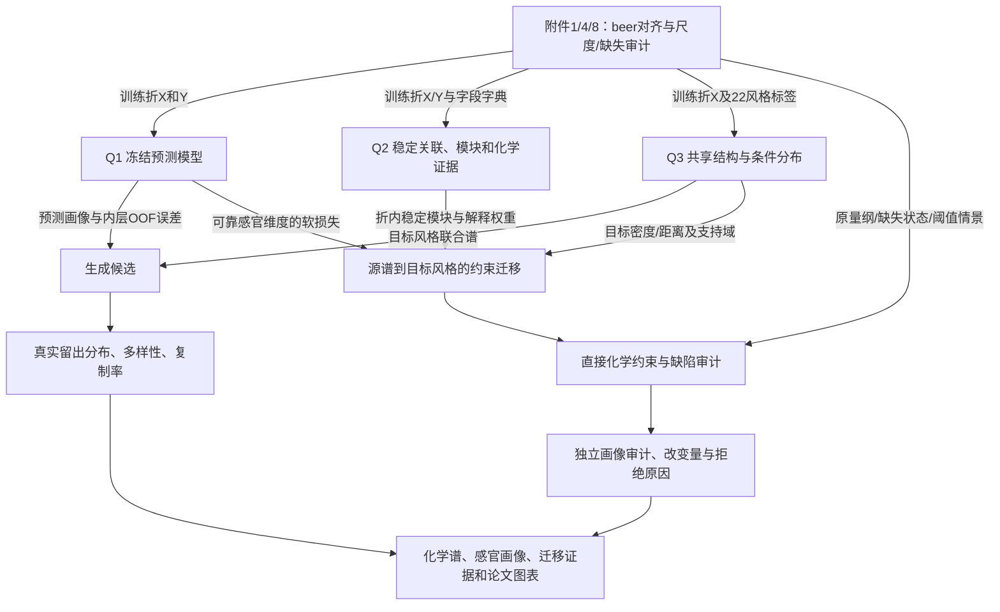

# Q3 独立方案与优化路线：从风格分布到受约束化学谱

> 版本 v4，2026-10-25；数据契约、生成基线、共享低秩消融与直接化学约束迁移已完成，最终感官画像和 Stale hops 代理尚未运行。独立推导见 `Q3_独立方案v0.md`（外部研究前提交 `88b04a0`）；证据与实际阅读范围见 `Q3_外部研究证据表.md`。Q1 v5 保持冻结，Q2 运行树不受本工作树影响。

## 1. 整题建模主线

推荐形成“**连续感官预测 → 稳定化合物证据 → 风格条件分布与受约束迁移**”的一套系统。Q1 回答化学谱对应怎样的感官画像，Q2 回答哪些关联值得解释，Q3 则寻找像目标风格、改动有节制、缺陷风险可审计的新谱。三问共享样本、字段、量纲和验证划分；生成模型仍须有独立的分布验证。

Q3 暂定主线为**共享低维化学结构 + 风格均值/协方差收缩 + 带支持域和拒绝机制的约束迁移**。经验重采样/近邻插值作最低基线，风格 Copula 和高斯输运作强基线，小型条件 VAE/条件扩散作 GPU 挑战者。选择由留出结果决定；当前不能宣布主线优于参考组。

主要技术贡献落在可检验的组合：保留缺陷显式坐标，传递 Q1 的逐目标可靠性，用 Q2 的稳定关联作可消融软信息，并对不可达、缺失、删失和代理模型失效保留拒绝。低秩、收缩或 OT 本身都是已有方法，不包装成自创算法。

## 2. 跨问题联动链

Q1 接口已经固定为 v5“感官组收缩NNLS”的只读注册表与 OOF 哈希，不再回退旧基线。Q2 结果当前只可作描述性解释；正式 Q3 外折的正则、特征或目标权重若依赖 Q2，必须在同一训练折重算，不能直接把全数据 Top-3/500 次 bootstrap 结果用于外折训练。

## 3. 全文统一口径与实际数据

| 对象 | 口径 | 三问使用方式 |
|---|---|---|
| 样本/主键 | 250 款，`beer` 唯一；22 个细分风格 | 连接和分折只按 beer；不使用 beer_id |
| 化学谱 x | 附件 1 的 231 个数值字段；保留官方存储尺度 | Q1 输入、Q2 统计对象、Q3 生成输出须一一对应 |
| 感官向量 y | 50 维标准化连续值 | Q1/Q3 的主要数值尺度；0—6 是折内经验分布的展示映射，不叫恢复真实评分 |
| 原量纲 c | 附件 8 可核验 70 字段（37 log10、33 原值） | 缺陷与物理边界审计；其余字段只输出已知尺度/相对丰度 |
| 缺失 | 73 单元/63 行；普通缺失沿用折内插补，保留状态 | Q3 完整输出是估计候选，不是补测；源缺陷缺失不产生已知真实上限 |
| 派生字段 | 5 个派生总量，与实测字段区分 | 公式已核验则在原量纲重算；没有公式不得随意求和，更不能对 log 值求和 |
| 图与关联 | 附件 2 为全量 Spearman；预测相关构图折内重算 | Q2 解释和 Q3 软正则不作因果解释 |
| 目标风格 | Tripel 28、Kriek 10、Lambic 11；源 Pils/Lager 11 | 三风格为主展示，不抛弃其他风格对共享结构的统计贡献 |

### 3.1 本轮只读检查新增的重要事实

| 字段/事实 | 当前观测 | 对模型和结论的影响 |
|---|---|---|
| 4VG 地板 | `1.csv:X4VG` 有 168 款同为 −2.013157381；对应校准表零；Kriek 10/10、Tripel 23/28、Lambic 10/11、Pils/Lager 9/11 为校准零 | 需要保留地板/未检出状态，不用连续高斯把所有点强行摊开；状态不自动等于已知 LOD 或真实零 |
| 双乙酰源值缺失 | Pils/Lager 的 beer=119、28 在 1.csv 为 NA、校准表为 0；全体共 9 个这种零/NA 对应 | 不拿附件 8 的零覆盖缺失后声称“浓度不升”；列为源基准未知、情景约束或待核验 |
| trans-2-nonenal | 阈值 mean/median 均缺；校准表 249 个非缺失，源 Pils/Lager 11 个齐全 | 同尺度相对不升可审计，OAV/阈下率不可凭样本 95% 分位冒充生理阈值 |
| DMS 风格冲突 | 以附件 median=19 μg/L 描述，Tripel 25/28 高于该值，Pils/Lager 3/11 | 只是当前数据描述，不是训练成绩；“严格不升+完全复现 Tripel 无条件分布”可能冲突，应研究可达目标，而不是承诺两者都完美 |

数据检查用附件原表按 beer 对齐后计数；零/NA 比较不依赖模型。以上事实必须在正式 E200 数据契约复算并保存哈希，当前数字不作为任何 Q3 性能。

## 4. 问题概述：任务、已知、输出、本质

- **任务：** 学习 `p(x|s)`；给定风格产生合理且多样的化合物谱与画像；把源谱迁移到目标风格并控制五类缺陷。
- **已知：** 商用啤酒横截面测量、风格标签、感官测量、部分真实单位与阈值；前两问的预测与关联证据。
- **输出：** 条件生成谱、三风格感官画像、11 个源样本逐款迁移/拒绝、直接缺陷与感官缺陷分层审计、留出评价和改动解释。题面没有规定每风格生成 300 条或专用 CSV 模板；生成数量是本队展示设置，非官方要求。
- **本质：** 小样本高维条件分布估计，结合有支持域限制的多目标统计设计；没有配方或干预对，无法识别真实工艺控制规律。

### 4.1 模型假设（均有检验与退出条件）

| 假设 | 数据依据与简化用途 | 失效处理 |
|---|---|---|
| H1：训练范围内测量尺度可比 | 同批附件和字段级原量纲核验支持连接 | 以尺度核验失败字段为不可用，禁止跨单位施加阈值 |
| H2：存在可跨风格共享的低维共变结构 | n=250、p=231，风格内估计明显不足 | 检查留出重构、缺陷保留和风格分布；失败转全维收缩或局部经验模型，不以 PCA 方差率证明生成质量 |
| H3：小风格的参数可部分向共享结构收缩 | 目标风格 n=10—28 | 无收缩/共享/分层对比；若共享削弱风格特征则减弱收缩，不能手调到留出最好 |
| H4：Q1 在训练支持域附近可给有误差的画像 | 既有 OOF 有可预测与弱信号维度分层 | 低可靠目标不作强优化项；分布外或模型分歧大则拒绝/降低证据等级 |
| H5：统计约束谱可作候选设计 | 题面只提供谱，没有原料/发酵控制量或干预对 | 不宣称能酿造/因果提升；后续需要新实测验证，不以自拟“同分布”假设代替检验 |

## 5. 总体求解思路与模型建立

### 5.1 表示层：完整谱、关键缺陷与派生量分开

1. 在训练折识别普通缺失、已核验地板与未知零。生成建模用折内尺度，Q1 输入仍通过它原有的预处理器；不在整个数据上重新变换。
2. Q2 的 218 单体白名单服务于解释排名，不能直接当作 Q3 全部输入：Q3 还需要理化参数和 Q1 所需的完整字段。
3. 共享结构先在基础测量字段拟合；把四个直接缺陷作为显式坐标或受约束重构残差保留。不能只取高方差主成分后丢弃低方差缺陷。
4. 对 4VG 等地板字段，先建“观测地板状态/非地板”概率，再建非地板值分布；两阶段是数据分布模型，不声明恢复地板以下的真实浓度。未知 LOD 时不捏造检测上限。
5. 5 个派生量优先按已核验定义生成。若定义未核验，先保留联合输出并给一致性残差；可用折内预测重构作软校验，但不写成化学恒等式。

这些字段包含浓度、理化量和相对丰度，并不构成总和为1的组分比例。不能统一作单纯形归一化或未经核验施加总质量守恒。生成谱也不回灌为Q1/Q2新增真实样本或验证标签；任何后续合成增强另立实验，只在训练折内进行，不能改变现有冻结结果。

### 5.2 生成主线：共享结构与风格收缩

在训练折标准化后的基础谱 `u` 上设

\[
u_i=\mu_{s_i}^{*}+Bz_i+\epsilon_i,\qquad
\mu_s^{*}=a_s\bar u_s+(1-a_s)\mu_0,\qquad
a_s=\frac{n_s}{n_s+\kappa_\mu}.
\]

`B` 是共享低维结构；`z` 的风格分布与残差共同表达风格内差异。共享协方差优先从**扣除训练折风格中心的残差**估计，避免把风格间差异全部误作风格内多样性。比较

\[
\Sigma_s^{*}=b_s S_s+(1-b_s)\Sigma_W+\eta I,
\qquad b_s=\frac{n_s}{n_s+\kappa_\Sigma}.
\]

第一实现采用低秩加对角噪声；全维收缩 Gaussian/Copula 作强基线。秩、收缩强度、边缘变换和残差噪声只用内层验证选，不用外层目标风格真实谱调生成参数。低维噪声与显式地板/缺陷坐标要有条件关联，不能先独立生成缺陷后随意拼接。

Ledoit–Wolf 支持协方差收缩这一构件，但不证明本题具体层级结构有效；需进行无收缩/共享残差/风格收缩消融。[原始论文](https://doi.org/10.1016/S0047-259X(03)00096-4)

### 5.3 感官画像：继承 Q1，并传递它的局限

对每个生成谱输出 50 维连续画像、折内经验 CDF 对应的 0—6 展示值、逐维预测可靠性。正文只取预先定义的少量可解释维度，完整 50 维进支撑材料。

软目标权重 `w_l` 来自当前外层训练折的内层 Q1 OOF（例如正 R² 与标准化误差），设上限防止少数维度独占；最终全数据 OOF 仅作事后报告，不能反向用于同一外折优化。对 `stale_hops` 等弱目标，宽区间/低权重不是“没有缺陷”的证据。

训练/优化画像器 `f_opt` 与审计画像器 `f_audit` 采用不同模型族且均只见当前训练折；优化器不可访问 `f_audit`。另比较生成谱的预测画像与真实留出风格的**实测 y**，同时以真实谱的 OOF 画像误差为基准，拆开预测误差与生成偏差。模型间一致仍不是新啤酒实测验证。

### 5.4 迁移：让目标靠近、改动成本和证据风险可分别核验

源谱为 `x0`，候选为 `x`，目标风格为 `t`。先以均值/协方差输运或局部目标样本产生多个起点，再在支持域中求解

\[
\min_{x\in\mathcal F(x_0)}
D_t(x)+\lambda_C\|W_C(u-u_0)\|_2^2
+\lambda_Y\sum_l w_l\left[f_{opt,l}(x)-m_{t,l}\right]^2
+\lambda_G R_G(u-u_0)+\lambda_U U(x).
\]

- `D_t` 为训练折目标风格密度/近邻距离；批量迁移还用去偏 Sinkhorn 分布距离审计。二者分开命名，不能把点到中心的 Mahalanobis 距离叫完整分布匹配。
- `W_C` 标准化不同单位；缺少制造成本，不把这种谱距离解释成实际成本。
- `m_t` 是训练折目标画像；`U` 反映支持域外、画像器分歧或重构异常。它是风险启发式，不能未经校准叫 95% 置信保证。
- `R_G` 为可选 Q2 模块正则。带符号边可用 `sum |g_jk|(delta_j-sign(g_jk)delta_k)^2`，非负但只是统计协同惩罚；必须与 λG=0 比较，不能把相关当作必然同时变动的工艺规律。
- 多起点和 λ 路径给出 Pareto 集；非凸问题报告可行解、终止条件与多起点差异，不声称全局最优。去偏 Sinkhorn 定义见 [Feydy et al.](https://proceedings.mlr.press/v89/feydy19a.html)。

如果采用离散输运，把违反缺陷或支持域的边禁用并检查可行性；某源行没有可行目标时输出拒绝，不能用巨大有限代价掩盖违反。非平衡/部分输运可作候选，但未被匹配质量必须计入拒绝率，不得只汇报成功样本。

### 5.5 五类缺陷：三种约束情景和一张分层审计表

题面说“以……等超阈值项为准”，没有唯一界定阈内升高是否算恶化。并列三个预注册情景，不混用：

\[
\begin{aligned}
\text{C1 严格相对不升： }&c_j(x)\le c_j(x_0),\\
\text{C2 超阈负担不升： }&[c_j(x)/\tau_j-1]_+\le[c_j(x_0)/\tau_j-1]_+,\\
\text{C3 不升且阈下： }&c_j(x)\le\min\{c_j(x_0),\tau_j\}.
\end{aligned}
\]

**C1 为主展示，C2/C3 为敏感性。** C2 可以等价写上界 `max(源值,阈值)`，但只是在阈下允许上升的情景，不能冒充 C1。C3 是追加更严格的改善要求；源值本来超阈时，λ=0 原源谱可能不满足 C3，所以必须保留未投影原源谱，再另列“仅修复缺陷”基线。之前对照文档中把 `min(源值,阈值)` 笼统当“严格不恶化”的表述在本报告中明确拆开。

| 缺陷 | 可直接审计的内容 | 暂不可保证的内容 |
|---|---|---|
| DMS | 已核验原单位；均值/中位阈值情景；相对变化 | 地板/测量误差下的真实未知浓度严格关系 |
| Diacetyl | 已观测源值可逐款比较；0.09/0.29925 mg/L 情景 | beer119/28 等缺失源值不能用零或一次中位数认证 |
| 4VG | 观测地板状态不恶化、非地板浓度比较、0.20/0.206333… mg/L 情景 | 未知 LOD 内真实浓度变化；不能把“未检出”写真实零 |
| trans-2-nonenal | 已知源值的同尺度/原单位相对不升 | 当前附件未给绝对阈值，不能宣布阈下或算虚构 OAV |
| Stale hops | 两个画像器的预测变化、误差与分布外风险 | 无单一化学列、无可识别原 0—6 阈值，不能实测认证不恶化 |

不确定源值若假设区间 `[L,U]`，要求对一切可能源浓度严格不升需候选 `≤L`，而不是 `≤U`。对于 `[0,LOD]` 会退化为候选零且现实不可认证，应拒绝或降低结论等级。不能通过改用宽松上界获得虚假的 100% 安全率。

数值投影只允许把超上限值下调，不能把原本更低值赋到上界。C1 下 λ=0 应严格等于源谱；完全不动虽满足 C1，也必须有单独的目标靠近条件才能算成功。软惩罚降违反率不构成严格可行保证。

## 6. 可用模型及选型比较

| 路线 | 变量、实现步骤 | 假设/优点 | 失败风险及验证 | 跨问接口与采用条件 |
|---|---|---|---|---|
| A 经验重采样/近邻插值 | 风格训练样本，局部随机权重，派生量校验 | 假设少、可解释、设立基准 | 复制与方差缩小；查近邻距离/覆盖/相关 | Q1 画像；Q2 解释；所有挑战者必须比较 |
| B 共享因子与风格收缩（主线） | 共享基底、风格偏移/残差、显式地板状态；约束优化 | 适合 250×231 和 n=10—28，生成与迁移共用支持域 | 丢低方差信号或收缩过度；查缺陷与留出分布 | Q1 可靠性软权重、Q2 图消融；胜出后才定主模型 |
| C 风格 Copula/全维收缩高斯 | 折内经验边缘、收缩协方差、采样；均值/高斯 OT 迁移 | 参数透明，覆盖单调非正态边缘 | 地板阶梯、尾部/联合依赖；约束后重评 | 强基线；若 B 的结构约束有害则替代 B |
| D 小型条件 VAE/扩散 | 22 风格共享编码、低容量网络、内层早停、多种子；同一可行域审计 | 非线性、GPU 可并行，不缺算力 | 记忆、塌缩、约束失效；查训练—留出差、复制率和覆盖 | 挑战者；不能以重构误差/风格率单项晋级；方法可行性见 [TabDDPM](https://proceedings.mlr.press/v202/kotelnikov23a.html) |
| E RL/DeepKriging | 暂无可识别的动作/状态转移，亦无自然空间坐标 | 当前缺乏任务结构支持 | 人造奖励/距离不能补足数据 | 不进入本轮；有发酵过程或实测干预数据再评估 |

**推荐模型：B 与 C 正面对照，A 必做，D 保留 GPU 挑战。** 算力充足允许更多种子、外层复算与敏感性，而不能增加真实样本。GPU 主要用于 D 或大批次可微输运；B/C 的小矩阵运算无须为使用 GPU 而改模型。

## 7. 多模型对比与验证设计

### 7.1 数据与划分：同源验证不能称外部验证

复用 Q1 固定 10×3 的 beer 索引，**不改变 Q1 协议**；Q3 自己的参数只在外训练内层选择。每次重复分别汇总，真实样本只在其验证折贡献评价。小风格每折真实样本极少，相关结构和 C2ST 要给数量/NA 原因，不静默用训练数据填满。

生成模型只用训练 X/s；画像器只用训练 X/Y；Q2 软信息同折重算。附件 2/5/6、附件 8 原模型 importance/SHAP 与原始研究训练数据同源，不能称独立外部验证。附件 7/公开 Kaggle 可做风格常识/描述符方向的辅助核验，不能与缺少化学测量的公开样本硬拼接为化学训练数据。

未迁移的真实目标样本是生成检验对象；迁移没有成对真值，所以只能评价可达目标与约束，不能报告“迁移真实 RMSE”。

### 7.2 评价轴与反例

| 主张 | 必报指标/基准 | 防止的虚高 |
|---|---|---|
| 学到条件分布 | 边缘 W1/训练尺度归一化；联合 energy/MMD/去偏 Sinkhorn；真实—真实同规模基准 | 只复现均值、只选最有利的距离 |
| 生成有覆盖而非复制 | 方差/覆盖、到训练/留出的近邻距离、精确/近重复率 | 抄训练样本、全部生成风格中心 |
| 风格方向合理 | 独立风格判别器的真实 OOF 与生成结果并列；真实—假 C2ST 另列 | 把 style accuracy 与 C2ST 混为一项；分类器自评 |
| 画像有参考价值 | 预测画像 vs 实测留出 y；两模型一致性；逐维可靠性与训练域检查 | 用同一个 Q1 生成目标、优化并验证造成循环 |
| 缺陷可控 | 原单位逐项差/阈值/违反幅度；未知/删失单列；样本级全项通过及单项通过分别报告 | 平均缺陷次数下降代替逐项不升；55 条约束通过比例冒充11款样本成功率 |
| 真正实现迁移 | 源→目标距离下降、改动量、可行性、身份保持、拒绝率 | λ=0 不动、投影修复后改源却称原源、只汇报成功样本 |

C2ST 需平衡真实/生成数量与独立分类留出；跨外折混合的依赖必须标明，不能把 30 折当独立样本。每折 n 太小无法训练/测试分类器时记 NA；按重复汇总 OOF 分布可作补充描述，不能据此宣称严格独立检验。近邻指标 k 必须适配真实样本数，不能把图像论文 k=5、N=10000 的配置照搬。[C2ST 原文](https://arxiv.org/pdf/1610.06545)、[密度/覆盖原文](https://proceedings.mlr.press/v119/naeem20a.html)

不确定性以独立 beer 为重采样单位；若给模型不确定区间，需重拟合相应训练步骤并按风格分层。重复 CV 是训练扰动诊断；不把重复数当样本数。对优化后/分布外候选不套标准 split-conformal 的无条件覆盖保证。

### 7.3 实验登记与当前状态

| 拟编号 | 范围与主要产物 | 对比/消融 | 进入条件 |
|---|---|---|---|
| E200 | Q3 字段/尺度/阈值/地板/源缺失契约，来源哈希 | 与 Q1/Q2 字典逐字段核对 | 已完成；只读契约，不拟合模型 |
| E201 | A：重采样、近邻插值、原源谱和仅修复基线 | 复制型/均值型负对照 | 已完成 30/30；近邻插值为经验基线 |
| E202 | C：标准化收缩高斯、风格收缩 Copula | 支持域截断/经验边缘、原始/稳健口径 | 已完成 30/30；Copula 进入迁移首选统计基线，高斯作消融 |
| E203 | B：共享低秩、风格残差收缩、地板状态 | 已完成 30/30；相关结构略好但 W1/energy/覆盖未超过 Copula，保留为结构消融 |
| E204 | 跨风格受约束迁移，逐源 Pareto/拒绝表 | 已完成；844 条候选谱、293 条前沿、47 条结构拒绝；已知直接约束可控，未知与 Stale hops 代理待核验 |
| E205 | Q1/Q2 接口增量 | 无画像软项、可靠画像项；无图/稳定图；优化器/审计器互换 | 基础迁移可复算后才加，避免堆叠失控 |
| E206 | 小型 CVAE / TabDDPM GPU 挑战 | 同拆分、同调参预算记录、同约束审计、多种子 | 可并行开发，正式运行仍排在已授权 Q1/Q2 后；当前未启动 |
| E207 | 冻结候选后的稳健性与交付审计 | 阈值 mean/median、地板情景、源缺失、极端风格、代理偏差 | 候选锁定；不得看审计后追调参数再当原审计 |

编号为本轮建议，未写入已完成实验日志，也没有对应成绩。先解决不可认证和评价器问题，再消耗 GPU。

### 7.4 候选替换条件（Q3 建议版，不改变 Q1 硬门槛）

先过数据/数值/已知直接缺陷硬检查；C1 数值违反必须为零，比较采用同一容差 `abs_tol+rel_tol*|source|`，数值容差不能用 0.1 感官单位充当“不升”。未知/删失基准仍列未知，不挤进100%分母。

模型比较以两条预登记主轴为准：条件联合分布差异（主 energy，去偏 Sinkhorn 敏感性）与可行迁移的目标靠近—改动前沿；另约束覆盖/复制率不劣化。正式运行前用训练内层/真实—真实基准确定有实际意义的差异和非劣界，写入配置并冻结；不等看到外层结果才设阈值。

复杂模型只有在相同外层协议下持续改善主轴且不牺牲弱风格、直接缺陷和多样性时晋级；否则保留简单模型，把未采纳方案如实写进附录。样本不足以分辨时报告区间与证据不足，不强行排出唯一第一。

## 8. 创新与改进方向

| 改进 | 基础方案 → 具体变动 | 可验证收益 | 风险/回退 |
|---|---|---|---|
| 保留缺陷的信息表示 | 纯 PCA → 显式缺陷/地板状态与共享潜变量耦合 | 缺陷分布、地板率与留出谱更准确 | 参数增多；失败回退全维收缩 |
| 接续前两问且控制误差 | 50维等权目标 → 内层 OOF 可靠性软权重；Q2 仅作模块消融 | 独立画像偏差与支持域风险下降 | 过度偏向易预测目标；完整逐维报告 |
| 可拒绝的风格迁移 | 无条件全量匹配 → 源特定可行域、缺失/删失拒绝、Pareto | 可行源样本数/拒绝原因清楚、违反幅度为零 | 成功率可能较低；不得降低安全口径换分 |
| 防代理投机的验证 | 单一分类概率 → 分布+独立画像+真实—真实基准 | 检出“风格率高但谱不合理”的反例 | 新画像器也有误差；不称真实感官认证 |

## 9. 论文落地与图表方案

Q3 正文先控制为 **3 张主图 + 1 张可选附图**，不再默认每问塞七张图：

1. 条件生成与真实留出：三风格的少量预设关键字段分布 + 联合质量/覆盖对照；降维散点只辅助，不能独自证明生成合理。
2. 风味指纹：风格×预设感官维度的热图或区间点图；实测/预测分开、可靠性有标识，避免50维拥挤雷达。
3. 迁移权衡与缺陷审计：目标靠近—改动 Pareto + 四化学缺陷和 stale 预测变化；拒绝、未知与违反都可见。
4. 附图：结构、阈值/地板与模型敏感性。

均用 R/ggplot2 `theme_mcup()`、中文呈现、300 dpi；无图片内整图图题，无灰底分面条，面板号加粗，图例不遮图。图题在论文中。未来 DOCX 以指定 agent Q3.docx 为版式模板，Heading/Body Text、原生 OMML 公式、公式1×3表、表题上/图题下，验图后嵌图；本轮不生成 DOCX。

| 目录 | 规划交付（当前尚未生成数值结果） |
|---|---|
| `02_代码/Q3_风格生成/` | src/configs/tests；数据契约、各基线、生成、迁移、独立评价、源哈希与可恢复入口 |
| `03_结果/Q3_风格生成/` | field_contract/threshold/scenario；外折指标；generated_chemistry/sensory/reliability；迁移逐源候选、直接缺陷表、感官风险、拒绝原因 |
| `04_图表/Q3_风格生成/` | R 脚本、源数据、图清单、审阅版本，不覆盖既有终稿 |
| `05_论文/Q3_风格生成/` | 问题分析、假设与口径、模型/算法、结果占位、公式符号、来源与最终交付包 |

## 10. 完整性与合理性/局限

条件生成、三风格展示、画像、跨风格迁移与五类缺陷均已有输出定义；没有把“风格中心接近”代替整个条件分布，没有把“无法判别真假”代替质量证明，也没有把未观测浓度或弱感官模型当确定真值。

当前主要不确定性是：地板与真实检出限、缺失源浓度、trans-2-nonenal 绝对阈值、派生量完整公式，以及候选谱缺少新实测。可以先按相对约束、状态模型和明确拒绝推进，不必等待这些信息才做全部分析；但它们限制最终可以作出的安全/工艺结论。

下一步进入 E205：用 Q1 v5 最终模型生成50维画像，并以不同模型族的审计画像器检查 Stale hops、支持域和代理投机；再从 E204 的前沿中冻结最终候选。E204 的 96.97% C1 路径目标靠近率不是最终成功率，当前仍没有五类缺陷真实安全率结论。
